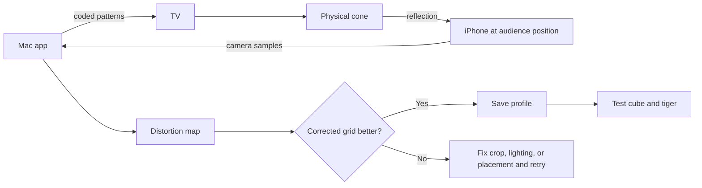

# Lab Test: Front-Audience Cone Calibration

Use this guide to decide whether the distortion map improves the physical cone
from the main audience position. The draft pull request must stay unmerged until
the corrected grid, cube, and tiger are visibly better than the uncorrected
output.

## What changed

- The Mac app can project coded calibration patterns onto the TV.
- An iPhone or other camera records how the cone bends those patterns.
- The app builds a smoothed inverse distortion map for one fixed audience view.
- Testers can compare corrected and uncorrected grids before saving the profile.
- The saved profile can correct the cube and animated tiger output.



## Before testing

- Use a clean checkout of draft PR #7 on branch `Sebastian-Garcia`.
- Connect the TV as an **extended display**, not a mirrored display.
- Place the cone in its final TV position and mark that position with tape.
- Mount the iPhone at the center audience position, at eye height, with its rear
  camera facing the cone. Mark the camera position and do not move it.
- Use a dark background, dim overhead lights, high TV brightness, and place the
  cone seam at the back when possible.
- Connect the iPhone through Continuity Camera. USB is preferred. Disable camera
  effects such as Center Stage.
- Record the cone, TV, camera, and audience measurements requested in
  `research/physical_test_plan.md`.

## Get the draft

Save or commit unrelated local work before switching branches.

```bash
git fetch origin
git switch Sebastian-Garcia
git pull --ff-only origin Sebastian-Garcia
cd Interface_mac
./setup_and_run.command
```

With the environment already installed, calibration can be opened directly:

```bash
cd Interface_mac
macenv/bin/python app.py --calibrate
```

## Run the calibration

1. Open **3D Model** and select **Calibrate cone for front audience**.
2. Start the camera and choose the iPhone. Confirm the preview is the iPhone's
   rear-camera view, not the Mac camera.
3. Choose the external TV under **Show patterns on**.
4. Drag a tight box around only the reflected image inside the cone. Exclude the
   directly visible TV surface below the reflection.
5. Keep the TV, cone, iPhone, and room lighting still. Capture all patterns. The
   sequence uses 23 patterns at 720p or 24 at 1080p and takes about 40 seconds.
6. Inspect **Distortion map**. Large black holes, an off-center map, or a map
   dominated by the cone base means the capture should be repeated.
7. Compare **Grid without correction** and **Grid with correction** from the
   same camera position. Record both views before changing anything.
8. Save the profile only when the corrected grid has visibly straighter lines,
   squarer cells, and a rounder center circle without severe cropping.
9. Close calibration. Select calibrated front output and test the cube, followed
   by **Tiger demo** with animation enabled.
10. Reopen the app and confirm that the saved profile still loads and corrects
    the same setup.

## Pass criteria

Mark the test **PASS** only when all of these are true:

- The iPhone, TV, pattern capture, cancel controls, and fullscreen close controls
  work without a crash.
- The corrected grid is clearly better than the uncorrected grid from the fixed
  front viewpoint.
- Grid lines are straighter, cells are closer to square, and the center circle
  is closer to round.
- The saved profile reloads and produces the same correction.
- The calibrated cube is less stretched and remains visible without important
  areas being cut off.
- The animated tiger stays recognizable and stable while moving.

Mark the test **RETRY** if the camera crop includes the visible TV, the setup
moved, coverage has large holes, glare hides the patterns, or correction makes
the grid worse. Physical seam, wrinkle, or overlap artifacts should be recorded
separately because software may not remove them.

## Evidence to add to PR #7

Post one PR comment containing:

- Tester name, date, and the output of `git rev-parse --short HEAD`.
- Mac model/macOS version, TV resolution, iPhone model, and chosen camera number.
- Cone measurements, marked camera distance/height, and lighting conditions.
- A fixed-camera video showing the uncorrected grid, corrected grid, cube, and
  animated tiger.
- A screenshot of the distortion map and its reported coverage.
- Result: **PASS**, **RETRY**, or **BLOCKED**, followed by the most visible issue.

Do not merge the draft PR after pattern capture alone. Merge only after the
corrected-versus-uncorrected comparison passes and the saved cube/tiger output
has been demonstrated.
